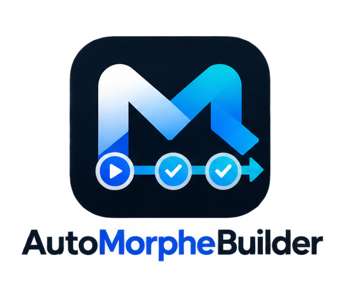

# AutoMorpheBuilder

<p align="center">
  
</p>

[](https://github.com/nxn94/AutoMorpheBuilder/actions/workflows/ci.yml)
[](https://github.com/nxn94/AutoMorpheBuilder/actions/workflows/codeql.yml)
[](https://github.com/nxn94/AutoMorpheBuilder/actions/workflows/morphe-build.yml)
[](https://github.com/nxn94/AutoMorpheBuilder/blob/main/LICENSE)


GitHub Actions pipeline that builds patched Android APKs with [Morphe patches](https://github.com/MorpheApp/morphe-patches), [morphe-desktop](https://github.com/MorpheApp/morphe-desktop), and [APKEditor](https://github.com/REAndroid/APKEditor). Outputs are signed, per-app versioned, and ready for Obtainium.

Forking for personal use is encouraged. To add or remove an app, edit `config.json` `patch_repos` — no workflow changes needed.

## Browser configuration UI

**[Open AutoMorpheBuilder UI](https://nxn94.github.io/AutoMorpheBuilder-UI/)** to load, edit and validate `config.json` and `patches.json` in your browser. Download the edited files and commit them to your fork; the UI does not automatically save changes back to GitHub or run builds. Signing secrets belong in GitHub Actions, not in the UI or either JSON file. See [SETUP.md](SETUP.md) for the full setup.

> [!IMPORTANT]
> **Legal and security notice.** This project downloads and modifies third-party Android applications using Google Play, APKMirror, APKPure and upstream patch repositories. You are responsible for ensuring that downloading, modifying and distributing the resulting APKs complies with each app's license, terms of service, and the laws of your jurisdiction. Builds fetch stock APKs from upstream sources and publish patched APKs as GitHub Release assets in the repository running the workflow. Forking and automated signing do not grant redistribution rights.
>
> The build signs patched APKs with **your** keystore (`KEYSTORE_BASE64` / `KEYSTORE_PASSWORD` / `KEY_ALIAS` / `KEY_PASSWORD`). Treat those secrets as production credentials: do not paste them into issues or PRs, do not reuse a personal keystore across experiments, and review the upstream patch repo before trusting it with your signing material. See [`SECURITY.md`](SECURITY.md) for the disclosure policy and how to report a vulnerability privately.

---

## Tested apps

<!-- BEGIN AUTOGENERATED: tested-apps -->
| App | Package | Patch repo |
|-----|---------|------------|
| YouTube | `com.google.android.youtube` | `MorpheApp/morphe-patches` |
| YouTube Music | `com.google.android.apps.youtube.music` | `MorpheApp/morphe-patches` |
| Reddit | `com.reddit.frontpage` | `MorpheApp/morphe-patches` |
| Sofascore | `com.sofascore.results` | `hoo-dles/morphe-patches` |
| Twitch | `tv.twitch.android.app` | `ryykitty/twitch-patched` |
| NZB360 | `com.kevinforeman.nzb360` | `rushiranpise/morphe-patches` |
| Flightradar24 | `com.flightradar24free` | `rushiranpise/morphe-patches` |
<!-- END AUTOGENERATED: tested-apps -->

---

## Workflows

| Workflow | File | Trigger | Purpose |
|----------|------|---------|---------|
| **Build Morphe-patched apps** | `morphe-build.yml` | daily 05:15 UTC + manual | Resolves per-app tags and supported APK versions → scheduled runs skip complete releases with matching build inputs → matrix download, patch, sign and verify → publish per-app APK/checksum/provenance assets and keep 2 releases per app. Manual runs force rebuilding. |
| **Update patches.json from upstream repos** | `update-patches.yml` | manual + push to `config.json` | Refreshes `patches.json` from each upstream patch repo. New patches default to `true`; existing toggles are preserved. |
| **CI** | `ci.yml` | PR + push to `main`/`dev` + successful metadata refresh on `main` | `npm ci` → `npm run check` (lint, tests, config, docs and README tables) → ShellCheck + actionlint. Config-only main pushes are validated after metadata refresh. |
| **CodeQL** | `codeql.yml` | PR + push to `main` + daily 06:00 UTC | Static security analysis (JavaScript/TypeScript + Actions). |

---

## Releases & Obtainium

Each app gets its own release with tag `<app>-v<base-version>-<patches-version>`:

```
youtube-v20.44.38-v1.24.0-dev.8.apk
ytmusic-v8.44.54-v1.24.0-dev.8.apk
sofascore-v26.07.27-v1.0.0.apk
```

Create one Obtainium entry per app against this repo with a Release Tag Filter matching `name`:

<!-- BEGIN AUTOGENERATED: obtainium-table -->
| App | Release Tag Filter | Add to Obtainium |
|-----|--------------------|------------------|
| YouTube | `^youtube` | <a href="https://apps.obtainium.imranr.dev/redirect?r=obtainium://app/%7B%22id%22%3A%22com.google.android.youtube%22%2C%22url%22%3A%22https%3A%2F%2Fgithub.com%2Fnxn94%2FAutoMorpheBuilder%2Freleases%22%2C%22author%22%3A%22nxn94%22%2C%22name%22%3A%22YouTube%22%2C%22preferredApkIndex%22%3A0%2C%22additionalSettings%22%3A%22%7B%5C%22includePrereleases%5C%22%3Afalse%2C%5C%22fallbackToOlderReleases%5C%22%3Atrue%2C%5C%22filterReleaseTitlesByRegEx%5C%22%3A%5C%22%5Eyoutube%5C%22%2C%5C%22filterReleaseNotesByRegEx%5C%22%3A%5C%22%5C%22%2C%5C%22verifyLatestTag%5C%22%3Afalse%2C%5C%22sortMethodChoice%5C%22%3A%5C%22date%5C%22%2C%5C%22useLatestAssetDateAsReleaseDate%5C%22%3Afalse%2C%5C%22releaseTitleAsVersion%5C%22%3Afalse%2C%5C%22trackOnly%5C%22%3Afalse%2C%5C%22versionExtractionRegEx%5C%22%3A%5C%22%5C%22%2C%5C%22matchGroupToUse%5C%22%3A%5C%22%5C%22%2C%5C%22versionDetection%5C%22%3Atrue%2C%5C%22releaseDateAsVersion%5C%22%3Afalse%2C%5C%22useVersionCodeAsOSVersion%5C%22%3Afalse%2C%5C%22apkFilterRegEx%5C%22%3A%5C%22%5C%22%2C%5C%22invertAPKFilter%5C%22%3Afalse%2C%5C%22autoApkFilterByArch%5C%22%3Atrue%2C%5C%22appName%5C%22%3A%5C%22%5C%22%2C%5C%22appAuthor%5C%22%3A%5C%22%5C%22%2C%5C%22shizukuPretendToBeGooglePlay%5C%22%3Afalse%2C%5C%22allowInsecure%5C%22%3Afalse%2C%5C%22exemptFromBackgroundUpdates%5C%22%3Afalse%2C%5C%22skipUpdateNotifications%5C%22%3Afalse%2C%5C%22about%5C%22%3A%5C%22%5C%22%2C%5C%22refreshBeforeDownload%5C%22%3Afalse%2C%5C%22includeZips%5C%22%3Afalse%2C%5C%22zippedApkFilterRegEx%5C%22%3A%5C%22%5C%22%7D%22%7D"></a> |
| YouTube Music | `^ytmusic` | <a href="https://apps.obtainium.imranr.dev/redirect?r=obtainium://app/%7B%22id%22%3A%22com.google.android.apps.youtube.music%22%2C%22url%22%3A%22https%3A%2F%2Fgithub.com%2Fnxn94%2FAutoMorpheBuilder%2Freleases%22%2C%22author%22%3A%22nxn94%22%2C%22name%22%3A%22YouTube%20Music%22%2C%22preferredApkIndex%22%3A0%2C%22additionalSettings%22%3A%22%7B%5C%22includePrereleases%5C%22%3Afalse%2C%5C%22fallbackToOlderReleases%5C%22%3Atrue%2C%5C%22filterReleaseTitlesByRegEx%5C%22%3A%5C%22%5Eytmusic%5C%22%2C%5C%22filterReleaseNotesByRegEx%5C%22%3A%5C%22%5C%22%2C%5C%22verifyLatestTag%5C%22%3Afalse%2C%5C%22sortMethodChoice%5C%22%3A%5C%22date%5C%22%2C%5C%22useLatestAssetDateAsReleaseDate%5C%22%3Afalse%2C%5C%22releaseTitleAsVersion%5C%22%3Afalse%2C%5C%22trackOnly%5C%22%3Afalse%2C%5C%22versionExtractionRegEx%5C%22%3A%5C%22%5C%22%2C%5C%22matchGroupToUse%5C%22%3A%5C%22%5C%22%2C%5C%22versionDetection%5C%22%3Atrue%2C%5C%22releaseDateAsVersion%5C%22%3Afalse%2C%5C%22useVersionCodeAsOSVersion%5C%22%3Afalse%2C%5C%22apkFilterRegEx%5C%22%3A%5C%22%5C%22%2C%5C%22invertAPKFilter%5C%22%3Afalse%2C%5C%22autoApkFilterByArch%5C%22%3Atrue%2C%5C%22appName%5C%22%3A%5C%22%5C%22%2C%5C%22appAuthor%5C%22%3A%5C%22%5C%22%2C%5C%22shizukuPretendToBeGooglePlay%5C%22%3Afalse%2C%5C%22allowInsecure%5C%22%3Afalse%2C%5C%22exemptFromBackgroundUpdates%5C%22%3Afalse%2C%5C%22skipUpdateNotifications%5C%22%3Afalse%2C%5C%22about%5C%22%3A%5C%22%5C%22%2C%5C%22refreshBeforeDownload%5C%22%3Afalse%2C%5C%22includeZips%5C%22%3Afalse%2C%5C%22zippedApkFilterRegEx%5C%22%3A%5C%22%5C%22%7D%22%7D"></a> |
| Reddit | `^reddit` | <a href="https://apps.obtainium.imranr.dev/redirect?r=obtainium://app/%7B%22id%22%3A%22com.reddit.frontpage%22%2C%22url%22%3A%22https%3A%2F%2Fgithub.com%2Fnxn94%2FAutoMorpheBuilder%2Freleases%22%2C%22author%22%3A%22nxn94%22%2C%22name%22%3A%22Reddit%22%2C%22preferredApkIndex%22%3A0%2C%22additionalSettings%22%3A%22%7B%5C%22includePrereleases%5C%22%3Afalse%2C%5C%22fallbackToOlderReleases%5C%22%3Atrue%2C%5C%22filterReleaseTitlesByRegEx%5C%22%3A%5C%22%5Ereddit%5C%22%2C%5C%22filterReleaseNotesByRegEx%5C%22%3A%5C%22%5C%22%2C%5C%22verifyLatestTag%5C%22%3Afalse%2C%5C%22sortMethodChoice%5C%22%3A%5C%22date%5C%22%2C%5C%22useLatestAssetDateAsReleaseDate%5C%22%3Afalse%2C%5C%22releaseTitleAsVersion%5C%22%3Afalse%2C%5C%22trackOnly%5C%22%3Afalse%2C%5C%22versionExtractionRegEx%5C%22%3A%5C%22%5C%22%2C%5C%22matchGroupToUse%5C%22%3A%5C%22%5C%22%2C%5C%22versionDetection%5C%22%3Atrue%2C%5C%22releaseDateAsVersion%5C%22%3Afalse%2C%5C%22useVersionCodeAsOSVersion%5C%22%3Afalse%2C%5C%22apkFilterRegEx%5C%22%3A%5C%22%5C%22%2C%5C%22invertAPKFilter%5C%22%3Afalse%2C%5C%22autoApkFilterByArch%5C%22%3Atrue%2C%5C%22appName%5C%22%3A%5C%22%5C%22%2C%5C%22appAuthor%5C%22%3A%5C%22%5C%22%2C%5C%22shizukuPretendToBeGooglePlay%5C%22%3Afalse%2C%5C%22allowInsecure%5C%22%3Afalse%2C%5C%22exemptFromBackgroundUpdates%5C%22%3Afalse%2C%5C%22skipUpdateNotifications%5C%22%3Afalse%2C%5C%22about%5C%22%3A%5C%22%5C%22%2C%5C%22refreshBeforeDownload%5C%22%3Afalse%2C%5C%22includeZips%5C%22%3Afalse%2C%5C%22zippedApkFilterRegEx%5C%22%3A%5C%22%5C%22%7D%22%7D"></a> |
| Sofascore | `^sofascore` | <a href="https://apps.obtainium.imranr.dev/redirect?r=obtainium://app/%7B%22id%22%3A%22com.sofascore.results%22%2C%22url%22%3A%22https%3A%2F%2Fgithub.com%2Fnxn94%2FAutoMorpheBuilder%2Freleases%22%2C%22author%22%3A%22nxn94%22%2C%22name%22%3A%22Sofascore%22%2C%22preferredApkIndex%22%3A0%2C%22additionalSettings%22%3A%22%7B%5C%22includePrereleases%5C%22%3Afalse%2C%5C%22fallbackToOlderReleases%5C%22%3Atrue%2C%5C%22filterReleaseTitlesByRegEx%5C%22%3A%5C%22%5Esofascore%5C%22%2C%5C%22filterReleaseNotesByRegEx%5C%22%3A%5C%22%5C%22%2C%5C%22verifyLatestTag%5C%22%3Afalse%2C%5C%22sortMethodChoice%5C%22%3A%5C%22date%5C%22%2C%5C%22useLatestAssetDateAsReleaseDate%5C%22%3Afalse%2C%5C%22releaseTitleAsVersion%5C%22%3Afalse%2C%5C%22trackOnly%5C%22%3Afalse%2C%5C%22versionExtractionRegEx%5C%22%3A%5C%22%5C%22%2C%5C%22matchGroupToUse%5C%22%3A%5C%22%5C%22%2C%5C%22versionDetection%5C%22%3Atrue%2C%5C%22releaseDateAsVersion%5C%22%3Afalse%2C%5C%22useVersionCodeAsOSVersion%5C%22%3Afalse%2C%5C%22apkFilterRegEx%5C%22%3A%5C%22%5C%22%2C%5C%22invertAPKFilter%5C%22%3Afalse%2C%5C%22autoApkFilterByArch%5C%22%3Atrue%2C%5C%22appName%5C%22%3A%5C%22%5C%22%2C%5C%22appAuthor%5C%22%3A%5C%22%5C%22%2C%5C%22shizukuPretendToBeGooglePlay%5C%22%3Afalse%2C%5C%22allowInsecure%5C%22%3Afalse%2C%5C%22exemptFromBackgroundUpdates%5C%22%3Afalse%2C%5C%22skipUpdateNotifications%5C%22%3Afalse%2C%5C%22about%5C%22%3A%5C%22%5C%22%2C%5C%22refreshBeforeDownload%5C%22%3Afalse%2C%5C%22includeZips%5C%22%3Afalse%2C%5C%22zippedApkFilterRegEx%5C%22%3A%5C%22%5C%22%7D%22%7D"></a> |
| Twitch | `^twitch` | <a href="https://apps.obtainium.imranr.dev/redirect?r=obtainium://app/%7B%22id%22%3A%22tv.twitch.android.app%22%2C%22url%22%3A%22https%3A%2F%2Fgithub.com%2Fnxn94%2FAutoMorpheBuilder%2Freleases%22%2C%22author%22%3A%22nxn94%22%2C%22name%22%3A%22Twitch%22%2C%22preferredApkIndex%22%3A0%2C%22additionalSettings%22%3A%22%7B%5C%22includePrereleases%5C%22%3Afalse%2C%5C%22fallbackToOlderReleases%5C%22%3Atrue%2C%5C%22filterReleaseTitlesByRegEx%5C%22%3A%5C%22%5Etwitch%5C%22%2C%5C%22filterReleaseNotesByRegEx%5C%22%3A%5C%22%5C%22%2C%5C%22verifyLatestTag%5C%22%3Afalse%2C%5C%22sortMethodChoice%5C%22%3A%5C%22date%5C%22%2C%5C%22useLatestAssetDateAsReleaseDate%5C%22%3Afalse%2C%5C%22releaseTitleAsVersion%5C%22%3Afalse%2C%5C%22trackOnly%5C%22%3Afalse%2C%5C%22versionExtractionRegEx%5C%22%3A%5C%22%5C%22%2C%5C%22matchGroupToUse%5C%22%3A%5C%22%5C%22%2C%5C%22versionDetection%5C%22%3Atrue%2C%5C%22releaseDateAsVersion%5C%22%3Afalse%2C%5C%22useVersionCodeAsOSVersion%5C%22%3Afalse%2C%5C%22apkFilterRegEx%5C%22%3A%5C%22%5C%22%2C%5C%22invertAPKFilter%5C%22%3Afalse%2C%5C%22autoApkFilterByArch%5C%22%3Atrue%2C%5C%22appName%5C%22%3A%5C%22%5C%22%2C%5C%22appAuthor%5C%22%3A%5C%22%5C%22%2C%5C%22shizukuPretendToBeGooglePlay%5C%22%3Afalse%2C%5C%22allowInsecure%5C%22%3Afalse%2C%5C%22exemptFromBackgroundUpdates%5C%22%3Afalse%2C%5C%22skipUpdateNotifications%5C%22%3Afalse%2C%5C%22about%5C%22%3A%5C%22%5C%22%2C%5C%22refreshBeforeDownload%5C%22%3Afalse%2C%5C%22includeZips%5C%22%3Afalse%2C%5C%22zippedApkFilterRegEx%5C%22%3A%5C%22%5C%22%7D%22%7D"></a> |
| NZB360 | `^nzb360` | <a href="https://apps.obtainium.imranr.dev/redirect?r=obtainium://app/%7B%22id%22%3A%22com.kevinforeman.nzb360%22%2C%22url%22%3A%22https%3A%2F%2Fgithub.com%2Fnxn94%2FAutoMorpheBuilder%2Freleases%22%2C%22author%22%3A%22nxn94%22%2C%22name%22%3A%22NZB360%22%2C%22preferredApkIndex%22%3A0%2C%22additionalSettings%22%3A%22%7B%5C%22includePrereleases%5C%22%3Afalse%2C%5C%22fallbackToOlderReleases%5C%22%3Atrue%2C%5C%22filterReleaseTitlesByRegEx%5C%22%3A%5C%22%5Enzb360%5C%22%2C%5C%22filterReleaseNotesByRegEx%5C%22%3A%5C%22%5C%22%2C%5C%22verifyLatestTag%5C%22%3Afalse%2C%5C%22sortMethodChoice%5C%22%3A%5C%22date%5C%22%2C%5C%22useLatestAssetDateAsReleaseDate%5C%22%3Afalse%2C%5C%22releaseTitleAsVersion%5C%22%3Afalse%2C%5C%22trackOnly%5C%22%3Afalse%2C%5C%22versionExtractionRegEx%5C%22%3A%5C%22%5C%22%2C%5C%22matchGroupToUse%5C%22%3A%5C%22%5C%22%2C%5C%22versionDetection%5C%22%3Atrue%2C%5C%22releaseDateAsVersion%5C%22%3Afalse%2C%5C%22useVersionCodeAsOSVersion%5C%22%3Afalse%2C%5C%22apkFilterRegEx%5C%22%3A%5C%22%5C%22%2C%5C%22invertAPKFilter%5C%22%3Afalse%2C%5C%22autoApkFilterByArch%5C%22%3Atrue%2C%5C%22appName%5C%22%3A%5C%22%5C%22%2C%5C%22appAuthor%5C%22%3A%5C%22%5C%22%2C%5C%22shizukuPretendToBeGooglePlay%5C%22%3Afalse%2C%5C%22allowInsecure%5C%22%3Afalse%2C%5C%22exemptFromBackgroundUpdates%5C%22%3Afalse%2C%5C%22skipUpdateNotifications%5C%22%3Afalse%2C%5C%22about%5C%22%3A%5C%22%5C%22%2C%5C%22refreshBeforeDownload%5C%22%3Afalse%2C%5C%22includeZips%5C%22%3Afalse%2C%5C%22zippedApkFilterRegEx%5C%22%3A%5C%22%5C%22%7D%22%7D"></a> |
| Flightradar24 | `^flightradar24` | <a href="https://apps.obtainium.imranr.dev/redirect?r=obtainium://app/%7B%22id%22%3A%22com.flightradar24free%22%2C%22url%22%3A%22https%3A%2F%2Fgithub.com%2Fnxn94%2FAutoMorpheBuilder%2Freleases%22%2C%22author%22%3A%22nxn94%22%2C%22name%22%3A%22Flightradar24%22%2C%22preferredApkIndex%22%3A0%2C%22additionalSettings%22%3A%22%7B%5C%22includePrereleases%5C%22%3Afalse%2C%5C%22fallbackToOlderReleases%5C%22%3Atrue%2C%5C%22filterReleaseTitlesByRegEx%5C%22%3A%5C%22%5Eflightradar24%5C%22%2C%5C%22filterReleaseNotesByRegEx%5C%22%3A%5C%22%5C%22%2C%5C%22verifyLatestTag%5C%22%3Afalse%2C%5C%22sortMethodChoice%5C%22%3A%5C%22date%5C%22%2C%5C%22useLatestAssetDateAsReleaseDate%5C%22%3Afalse%2C%5C%22releaseTitleAsVersion%5C%22%3Afalse%2C%5C%22trackOnly%5C%22%3Afalse%2C%5C%22versionExtractionRegEx%5C%22%3A%5C%22%5C%22%2C%5C%22matchGroupToUse%5C%22%3A%5C%22%5C%22%2C%5C%22versionDetection%5C%22%3Atrue%2C%5C%22releaseDateAsVersion%5C%22%3Afalse%2C%5C%22useVersionCodeAsOSVersion%5C%22%3Afalse%2C%5C%22apkFilterRegEx%5C%22%3A%5C%22%5C%22%2C%5C%22invertAPKFilter%5C%22%3Afalse%2C%5C%22autoApkFilterByArch%5C%22%3Atrue%2C%5C%22appName%5C%22%3A%5C%22%5C%22%2C%5C%22appAuthor%5C%22%3A%5C%22%5C%22%2C%5C%22shizukuPretendToBeGooglePlay%5C%22%3Afalse%2C%5C%22allowInsecure%5C%22%3Afalse%2C%5C%22exemptFromBackgroundUpdates%5C%22%3Afalse%2C%5C%22skipUpdateNotifications%5C%22%3Afalse%2C%5C%22about%5C%22%3A%5C%22%5C%22%2C%5C%22refreshBeforeDownload%5C%22%3Afalse%2C%5C%22includeZips%5C%22%3Afalse%2C%5C%22zippedApkFilterRegEx%5C%22%3A%5C%22%5C%22%7D%22%7D"></a> |
<!-- END AUTOGENERATED: obtainium-table -->

---

## Required secrets

Signed builds are enforced — missing `KEYSTORE_BASE64` or `KEYSTORE_PASSWORD` = build fails.

| Secret | Required | Description |
|--------|----------|-------------|
| `KEYSTORE_BASE64` | yes | Base64 of your keystore |
| `KEYSTORE_PASSWORD` | yes | Keystore password |
| `KEY_ALIAS` | no | Defaults to first alias in keystore |
| `KEY_PASSWORD` | no | Only if key password ≠ keystore password |
| `APKMIRROR_API_USER` | no | Enables the APKMirror-API provider; browser fallback remains available if needed |
| `APKMIRROR_API_PASS` | no | APKMirror-API password |

---

## APK download

Validated local/pre-downloaded APKs under `tools/apks/` are reused first. Otherwise the downloader tries **goopdl (Google Play)** → URL cache (`~/.cache/auto-morphe-builder/urls/`) → `config.json download_urls` → parallel resolution via **apkeep** (APKPure), **APKMirror-API** (if credentials are set), and the **APKMirror scraper**, followed by the full-browser download fallback. The parallel resolver preserves fixed source priority (`apkeep` → `apkmirror-api` → `apkmirror`); validation failures continue through the existing fallbacks.

Google Play uses verified stock ARM64 version-code mappings or discovers the exact requested version and architecture from APKMirror metadata. If discovery is unavailable, goopdl receives the explicit version name, never an implicit "latest". No personal Google account is required. On GitHub-hosted runners, where Play refuses anonymous logins, it's skipped unless the repository variable `GOOPDL_ON_GITHUB_RUNNERS` is `on`. Optional installation, download or validation failures do not disable the other providers.

APKMirror uses a warmed full-Chromium session with a matching Chrome user-agent and bounded challenge waits/retries. Persistent Cloudflare blocks are reported explicitly; no browser setup guarantees access from every runner IP.

Split packages (XAPK/APKM/APKS) are detected by **content**, even when saved as `.apk`. APKEditor merges them before final package, exact-version, dex and ABI validation. File size alone is not architecture evidence. See [architecture](docs/architecture.md#google-play-first) for integrity checks and anonymous authentication-pool handling.

---

## APK selection

- Architecture: `preferred_arch` from `config.json` (default `arm64-v8a`)
- DPI preference (APKMirror only): `nodpi` → `120-640dpi` → `480-640dpi` → `120-480dpi` → `240-480dpi`
- Split packages: APKEditor merge → fallback to dex-bearing APK extraction
- Rejects dex-less APKs (must contain `classes*.dex`)

---

## Signing

1. The `build` job patches with `morphe-desktop patch --unsigned` and holds no signing secrets
2. `create-release`, which runs no patch code, signs each APK with `apksigner` and verifies it
3. Any signing error fails the job before anything is published

---

## Common failures

- **`Chosen APK has no classes.dex`** — split/config APK picked. The post-merge step re-validates `base.apk`'s versionName for XAPK/APKM/APKS bundles.
- **`[pkg] could not determine version`** — `morphe-desktop list-versions` returned no matching version. Verify `patch_repos[*].repo` actually publishes a `.mpp` for your app.
- **`Wrong version of key store`** — wrong `KEYSTORE_PASSWORD`, or `KEY_PASSWORD` differs from keystore password.
- **ARM64 requested but only armeabi-v7a libraries arrive** — the downloaded variant is incompatible. Keep ABI validation enabled; check the selected source/variant and use another valid provider or a known-good `pin_version`.
- **Obtainium not finding updates** — verify the Release Tag Filter regex matches the `name` field in `config.json`.

For the full catalogue of symptoms, causes, and fixes see [`docs/troubleshooting.md`](docs/troubleshooting.md).

---

## Documentation

- [`docs/configuration.md`](docs/configuration.md) — every `config.json` field, with type, required-ness, example, and validation rules.
- [`docs/architecture.md`](docs/architecture.md) — pipeline architecture, the `check-versions` → `build` → `create-release` job graph, and the signing model.
- [`docs/troubleshooting.md`](docs/troubleshooting.md) — symptom / cause / fix catalogue for every common failure mode.
- [`docs/release-process.md`](docs/release-process.md) — release tag format, per-app isolation, pruning (`KEEP_COUNT`), and rollback procedure.
- [`SETUP.md`](SETUP.md) — step-by-step fork + signing keystore + GitHub Actions secrets walkthrough.
- [`CONTRIBUTING.md`](CONTRIBUTING.md) — how to file issues, send PRs, and validate locally before pushing.
- [`SECURITY.md`](SECURITY.md) — vulnerability disclosure policy and how to report a private issue.

---

## License

Licensed under the GNU General Public License v3.0. See [LICENSE](LICENSE).
