# Architecture

AutoMorpheBuilder is a **GitHub Actions pipeline** that produces signed, patched Android APKs and publishes them as per-app GitHub Releases. There is no application code to run locally — the workflow files, shell pipeline, and Node.js helpers under `.github/scripts/` **are** the product.

## High-level flow

1. **`check-versions`** resolves per-app patch tags and the CLI tag, then skips only complete releases with matching build-input provenance. Manual runs force rebuilding.
2. **`build`** (matrix per app, no signing secrets) downloads the APK, runs `morphe-desktop patch --unsigned`, and uploads an unsigned APK artifact.
3. **`create-release`** (gated by the `signing` GitHub environment) downloads the unsigned APKs, signs and verifies them with `apksigner`, publishes one GitHub Release per app, and prunes the oldest beyond `KEEP_COUNT`.
4. **`report-compat-failures`** runs only when the compat probe dropped an app. It fails the run and names the dropped apps, while the remaining apps still build.

`build` patches with `morphe-desktop patch --unsigned` and holds no signing secrets. `create-release`, which runs no patch code, decodes the keystore and signs with `apksigner` (`sign_apks.sh`), then verifies each APK. Separate jobs matter: a later step in the same job could be reached by a process a malicious patch left running.

```mermaid
flowchart TD
    A[schedule: daily 05:15 UTC<br/>or workflow_dispatch] --> B[check-versions job]

    B --> B1[Resolve latest tags<br/>check_versions.sh]
    B1 --> B2[Set up Java 21]
    B2 --> B3[Preflight per-app patch availability<br/>preflight-apps.js]
    B3 --> B4[Download morphe-desktop + per-repo .mpp<br/>download_morphe_tools.sh]
    B4 --> B5[Validate deferred metadata<br/>exact verified MPP + configured CLI]
    B5 --> B6[Compat probe per app<br/>compat-probe.js runs list-versions, classifies stderr<br/>for NoSuchMethodError / NoClassDefFoundError / VerifyError]
    B6 --> B7[Filter matrix by complete matching releases<br/>check_existing_releases.sh]
    B7 --> B8{should-build?}
    B8 -->|false| Z1[build + create-release skipped<br/>no-op day]
    B8 -->|true| B9[Reuse validated Node dependencies]
    B9 --> B10[Cache + install Playwright Chromium]
    B10 --> GP[Install optional goopdl]
    GP --> B11[Cache + install apkeep]
    B11 --> B12[Install aapt]
    B12 --> B13[Pre-download APKs in parallel<br>pre_download_apks.sh]
    B13 --> C[build job matrix per app<br/>no signing secrets]

    C --> C1[Checkout + Java 21]
    C1 --> C2[Restore apkeep artifact]
    C2 --> C3[Restore pre-downloaded APKs]
    C3 --> C4[Cache + fetch morphe tools<br/>fetch_morphe_tools.sh<br/>morphe-desktop.jar always re-downloaded]
    C4 --> C5[Resolve supported version<br/>prepare_target_version.sh]
    C5 --> CF{Usable local APK?}
    CF -->|no| CB[Cache + install fallback browsers]
    CB --> C6
    CF -->|yes| C6[Download supported APK<br/>download-supported-apk.js<br/>multi-source fallback chain]
    C6 --> C8[Patch APK<br/>patch_apk.sh runs morphe-desktop patch --unsigned]
    C8 --> C9[Upload unsigned APK as artifact<br/>per-app <name>-v<ver>-<patches>]

    C9 --> D[create-release job<br/>environment: signing<br/>signs with apksigner]

    D --> D1[Download unsigned APKs from build<br/>pattern *-v* with merge-multiple]
    D1 --> DS[Install build-tools, align, sign and verify<br/>sign_apks.sh]
    DS --> D2[Publish per-app releases<br/>create_release.sh<br/>tag = name-v apk -v patches]
    D2 --> D3[Prune old releases per app<br/>prune_old_releases.sh<br/>keep KEEP_COUNT = 2 by default]

    style B6 stroke-dasharray: 4 4
    style C4 stroke-dasharray: 4 4
    style C stroke:#c00,stroke-width:3px
```




## Jobs in detail

### `check-versions`

Runs first. Failures here short-circuit the rest of the workflow.

| Step | Script | Purpose |
|------|--------|---------|
| Resolve latest Morphe + CLI versions | `pipeline/check_versions.sh` | Emits the optimistic default (`should-build=true`, full matrix) — the downstream filter overrides it. |
| Set up Java 21 | `actions/setup-java@v5` | Required for `java -jar morphe-desktop.jar`. Default runner Java is older and fails to invoke the jar. |
| Preflight per-app patch availability | `scripts/preflight-apps.js` | Uses the shared resolver for exact tagged raw metadata or a same-release asset. Missing usable compatibility is explicitly deferred until verified tools exist; usable metadata rejects unsupported packages. |
| Download morphe-desktop + patches `.mpp` | `pipeline/download_morphe_tools.sh` | Provides the jar + per-repository/tag `.mpp` files the filter step needs. Runs **unconditionally** so the filter step runs before the expensive Playwright / apkeep / aapt installs. |
| Validate deferred patch metadata | `scripts/preflight-apps.js` with `CLI_TAG` | Immediately after verified tool download, derives missing metadata from the exact MPP and configured CLI, validates packages, and writes per-tag metadata atomically. Errors stop before APK downloads and filtering. |
| Compat probe | `scripts/compat-probe.js` | Actually invokes `morphe-desktop list-versions` per app to catch runtime API mismatches the static preflight can't see (e.g. hoo-dles/morphe-patches using `BytecodePatchBuilder.extendWithAll(Supplier)` added to morphe-patcher 2026-07-27, which only morphe-desktop v1.13.2+ carries). |
| Filter matrix by existing releases | `pipeline/check_existing_releases.sh` | For each app, resolves the APK version (pinned or via `morphe-desktop list-versions`) and drops entries whose release has matching build-input provenance and all required assets. **Fail-open**: if version resolution or `gh release view` errors, the app is kept in the matrix. `FORCE_BUILD=1` on `workflow_dispatch` skips the check. |
| Node dependencies | `actions/setup-node` + `npm ci` | Installed once before configuration validation; matrix jobs use the npm cache with `npm ci --omit=dev`. |
| Cache + install Playwright | `actions/cache@v5` + `pipeline/install_playwright.sh` | The custom installer bypasses a yauzl extraction bug in Playwright 1.58. |
| Install apkeep + aapt | `pipeline/install_apkeep.sh` + `pipeline/install_aapt.sh` | apkeep is pinned to SHA-256 against `APKEEP_VERSION`. |
| Install optional goopdl | `pipeline/install_goopdl.sh` | Commit-pinned Python virtualenv; installation failure warns without disabling existing sources. Also installed in each build job. Skipped on GitHub-hosted runners unless repository variable `GOOPDL_ON_GITHUB_RUNNERS` is `on`. |
| Pre-download APKs in parallel | `pipeline/pre_download_apks.sh` | Per-app `&` + `wait`. Honours `SKIP_LIST` from the filter step. Calls `update-download-urls.js` per app (writes back only when `auto_update_urls=true` and no `pin_version` is set). |

Repository variable `PRE_DOWNLOAD=off` skips the pre-download and its artifact. Each `build` job then downloads its own APK, which saves `check-versions` time and artifact storage for forks that build few apps. The default is unchanged.

**Notes:**

- The CLI jar is **never** cached. `download_morphe_tools.sh` always `rm -f` and re-downloads it, because `actions/cache@v5` only saves on a cache miss — a restore would silently put a stale jar back into `tools/`. Both download scripts verify the jar's `Implementation-Version` from `META-INF/MANIFEST.MF` matches `CLI_VERSION` after download.
- The compat probe classifies stderr for `NoSuchMethodError`, `NoClassDefFoundError`, `IncompatibleClassChangeError`, `VerifyError`, `LinkageError` and emits an actionable `::error::` ("bump cli or pin each affected app to an older patch tag") instead of waiting 30 minutes for the matrix to surface the same crash.

### APKPure by exact build number

When the patch list publishes `versionCodes` for the version, `src/download/apkpure-exact.js` tries APKPure's address for each build number after Google Play and before the URL cache. Files get the usual package, version, ABI and signature checks; any failure continues through the existing chain.

### Google Play first

`unified-downloader.js` tries `goopdl-downloader.js` before the existing URL cache and providers. The optional installer pins upstream goopdl 1.2.2 to commit `30c43eb0f4e06d5ab0a45e39c559a2869a2c7d68` in a Python virtualenv under `tools/goopdl/`. No personal Google account is required.

On GitHub-hosted runners the installer is skipped unless the repository variable `GOOPDL_ON_GITHUB_RUNNERS` is `on`: Google Play's anonymous token dispenser answers their IP ranges with HTTP 403 for every device profile, so the attempt only adds time. Self-hosted runners and local runs are unchanged. Without the binary, the downloader skips Play and continues with the existing sources.

- `.github/scripts/goopdl-version-codes.json` provides verified **stock ARM64** codes as a fast path. For unmapped versions, the downloader discovers a code from APKMirror's exact release and architecture-specific variant metadata, checking both package and version name. If APKMirror can't help (no mapping, or blocked), it takes the ARM64 build number from APKPure's version listing, the same variant APKPure's own download step picks. If neither works, it passes the explicit version name to goopdl's resolver. A discovered code is only a hint: if Play can't deliver it, or the delivery fails any check, the downloader asks again by the exact version name, with the same checks. It never requests an unversioned/latest download. Other architectures still fall back to existing providers. Never derive stock codes from patched APKs or treat current rollout cohorts as a historical catalogue.
- Each delivery explicitly includes splits. Every APK is checked against the delivery's SHA-256/size and its package/version-code manifest; the base must match the requested version name. The existing ABI validator rejects wrong-architecture deliveries before success. Split deliveries become local `.apkm` bundles for the existing APKEditor merge and final validation path; standalone APKs stay `.apk`.
- Any installation/download/validation failure continues through the existing source chain. Play downloads are bounded to 180 seconds, including at most 30 seconds waiting for the anonymous-pool lock; optional metadata discovery runs first with bounded browser navigation. A missing optional goopdl binary skips discovery immediately.
- Parallel apps share a dedicated mode-0700 anonymous authentication HOME at `${TOOLS_DIR:-tools}/goopdl-home`, protected with Linux `flock -F`. Reusing the pool avoids requesting a new batch of anonymous tokens for every app. Personal account environment variables are removed. **Never cache/upload this HOME or log subprocess authentication output.** Temporary delivery files are deleted after success or failure.
- A Play result supplies a local file, not a reusable URL. Pre-download accepts that file without updating `config.json` or the URL cache with expiring signed delivery URLs. Uploaded APK artifacts contain only `tools/apks/`, not the authentication HOME.

APKMirror browser paths share a full Chromium session (`channel: chromium`), a Chrome user-agent matching the installed browser, and an initial homepage visit before release/variant/download navigation. This avoids the previous Firefox-UA/Chromium mismatch and headless-shell fingerprint. Navigation checks HTTP status and challenge titles, waits briefly and retries once before reporting a persistent Cloudflare block. The same browser context carries cookies through the download; no third-party challenge-solving service or credentials are added. Cloudflare can still block an IP: such failures must preserve the other providers rather than weaken exact-version or ABI validation.

### `build`

Per-app matrix. Already filtered to apps that need rebuilding by `check-versions`. `fail-fast: false` so a single app failure does not cancel the others.

Holds no signing secrets. Untrusted inputs (APKMirror HTML/JSON, third-party patch tools) are processed here, and the APKs it uploads are unsigned.

| Step | Purpose |
|------|---------|
| Checkout + Java 21 | Standard runner setup. |
| Restore apkeep / pre-downloaded APKs | `actions/download-artifact@v8` from `check-versions` artifacts. |
| Cache + fetch morphe tools | `fetch_morphe_tools.sh` re-downloads `morphe-desktop.jar` fresh, then per-app `.mpp` and `APKEditor.jar`. The `.mpp` is restored from cache with **exact-key match only** — no `restore-keys` fallback. A `restore-keys: morphe-patches-<slug>-` would silently restore an `.mpp` from an older patch tag when the matrix moves forward (e.g. Twitch `v1.3.1` → `v1.3.2`), which `morphe-desktop list-versions` would then read to produce a stale APK version; the build would silently re-create an already-released APK and the former publisher would skip the upload. Forcing an exact-key match forces `fetch_morphe_tools.sh` to re-download the `.mpp` from `gh release download` whenever the patch tag moves. The `.mpp` is verified against the per-asset digest served by the GitHub release API (`gh_asset_sha256`) before the build continues — a stale cache entry that survived a matrix-tag move fails the SHA check, is deleted, and re-downloaded, for the current run. Exact-key entries are immutable; delete a corrupt entry or advance its key to repair storage. |
| Resolve supported version | `prepare_target_version.sh` + `list-versions`. Legacy pinned apps skip the CLI call. Shared token extraction preserves complete version suffixes. Generated metadata intersects effective patch compatibility and validates pins; the probe passes the same target into the matrix and predownload. Twitch now uses `ryykitty/twitch-patched`; the retired De-Vanced source is not configured. |
| Cache APK | `actions/cache@v5` keyed on `apk-<name>-<version>`. |
| Install aapt | For post-download version validation. |
| Download supported APK | `download-supported-apk.js`. Reuse validated local/pre-downloaded APKs; otherwise try **goopdl (Google Play)** → URL cache (`~/.cache/auto-morphe-builder/urls/`) → `config.json download_urls` → parallel resolution via apkeep (APKPure), APKMirror-API (if creds), APKMirror scraper (curl → Chromium fallback). **Cleanup on failure** removes partial APK on ABI / version validation throw so a stale file does not pre-empt the good one. |
| Patch APK | `patch_apk.sh` runs `morphe-desktop.jar patch --unsigned`. |
| Upload unsigned APK | `${{ matrix.name }}-v${{ version }}-${{ patches-tag }}` artifact. Signing occurs only in `create-release`. |

### `create-release`

Depends on `check-versions` and `build`; publishes successful matrix artifacts even when another app failed. Skips when no build was requested or the build was cancelled. Only this job uses the `signing` GitHub environment.

| Step | Purpose |
|------|---------|
| Download unsigned APKs from build job | `actions/download-artifact@v8` with `pattern: '*-v*'` + `merge-multiple: true` — pulls every `<name>-v<ver>-<patches>` artifact the `build` matrix uploaded. |
| Install build-tools and sign APKs | `install_aapt.sh` provides `zipalign` and `apksigner`; `sign_apks.sh` aligns when needed, signs with the release keystore, and verifies each output before publication. Any failure stops the job. |
| Publish per-app releases | `create_release.sh` creates or updates one GitHub Release per app, tag `<name>-v<base-version>-<patches-version>`, containing that app's APK, `SHA256SUMS` and `build-inputs.json`. |
| Prune old releases | `prune_old_releases.sh` caps each app's release history at `KEEP_COUNT` (default `2`) by `gh release delete --cleanup-tag` on the oldest beyond the window. Failures on a single tag (race / already gone) are warnings only. |

## Source layout

```
.github/
├── workflows/             YAML entrypoints (morphe-build, ci, codeql, update-patches)
├── scripts/
│   ├── *.js               Top-level Node.js helpers (downloaders, validators, install scripts)
│   ├── __tests__/         Jest tests for the helpers above
│   └── pipeline/
│       ├── *.sh           One shell script per workflow step
│       └── lib/           Sourced helpers shared across *.sh
├── ISSUE_TEMPLATE/        Issue templates + config.yml
├── pull_request_template.md
└── CODEOWNERS             Required reviewers per path

config.json                Build config (this repo's "settings")
patches.json               Patch toggles (repo-keyed: { "owner/repo": { "pkg": { "Patch": true } } })
patches-list.json          Per-matrix metadata from the shared exact-tag resolver (managed)
<patchSlug>.metadata.json  Check-versions metadata isolated by repo/tag (managed)
metadata-artifacts/        Digest-addressed verified fallback binaries; disposable CLI execution state
LICENSE                    GPL-3.0
SECURITY.md                Vulnerability disclosure policy
CONTRIBUTING.md            How to file issues, send PRs, validate locally
docs/                      This documentation
```

## Signing model

Signing is enforced end-to-end. `build` patches with `morphe-desktop patch --unsigned` and holds no signing secrets. `create-release`, which runs no patch code, decodes the keystore and signs with `apksigner` (`sign_apks.sh`), then verifies each APK.

1. **Alias + entry password.** When `KEY_ALIAS` is unset, `sign_apks.sh` uses the first alias from `keytool -list`. When `KEY_PASSWORD` is unset, it uses `KEYSTORE_PASSWORD`.
2. **Hard-fail.** A missing secret, wrong password or failed `apksigner verify` stops `create-release` before anything is published.

**Trust boundary.** The signing secrets are referenced only by `create-release`. A code-execution bug during APK download or patching cannot reach the keystore, although it can still tamper with the APK it is producing. Pin the patch repo (`pin_patch_tag`) and APK version (`pin_version`) to limit that.

Required secrets: `KEYSTORE_BASE64`, `KEYSTORE_PASSWORD`. Optional: `KEY_ALIAS` (auto-detected as the keystore's first alias via `keytool -list` when unset), `KEY_PASSWORD` (defaults to `KEYSTORE_PASSWORD` when unset). Use PKCS12 or JKS. Existing BKS keystores must be converted locally with a suitable provider, preserving the private key and certificate; do not generate a replacement key, which would break upgrade compatibility.

**Original APK signer.** Before any merge or patch, `download-supported-apk.js` checks that the original APK (or, in a bundle, every APK the merge will use: the base and every split) is signed by a certificate listed for the app in `.github/scripts/apk-signers.json`, using `apksigner verify --print-certs` (`src/download/signer.js`). A wrong signer or an unverifiable original fails the app. Unlisted apps are skipped with a notice. The one exception is this builder's own cached merge (`<appId>.apk`, unsigned by nature): its bundle is checked and merged again instead.

## Failure model

The workflow is **fail-open** on version resolution (per app) and **fail-closed** on signing and on patch availability. See `docs/troubleshooting.md` for the catalogue of common failure modes and their remediation.

## Shared build state and validation

`build-plan.js` constructs each app's resolved tag and tag-derived bundle slug.
The compatibility probe writes `tools/supported-versions.json`; filtering,
pre-download, and matrix resolution reuse those versions. The check job never
restores archives over freshly verified tools. Signing secrets are referenced
only in the signing step of the separate `create-release` job. The final selected/merged APK must pass archive,
package ID, exact version, dex, and native ABI checks. Pure Java APKs need no
native ABI. Unsigned patched output must appear at the declared path before
artifact upload; `create-release` signs it and requires `apksigner verify`
before publication.

URL metadata is cached separately, bounded to three recent versions per app.
Matrix jobs restore it after the check job completes. Every cached URL still
requires an HTTPS HEAD probe; every APK still passes the final validation.

## Further performance measurements

CI shares one validation job for ordinary events and the trusted metadata-update
follow-up. The latter still checks out literal `refs/heads/main`, never upstream
head data. `setup-node` caches npm downloads; `npm run check` remains the single
source of truth for JavaScript, test and documentation checks. npm installs omit
audit/funding requests (Dependabot remains responsible for vulnerability alerts).
Pre-downloaded APK artifacts use compression level zero, like signed artifacts.
Release publishing shares the metadata updater's non-cancelling concurrency group;
the long-running build does not hold that write lock. See
[workflow optimization](workflow-optimization.md) for scope and limits.

This revision removes the observed stale check-stage restore, duplicate dependency
install, `node_modules` artifact, and approximately 536 MiB browser artifact.
Measure both no-change schedules and full manual builds on GitHub before claiming
wall-clock savings. Pre-downloaded APKs still use a combined artifact with isolated
package subdirectories. Per-app artifact delivery, lazy APKEditor provisioning,
and cancellation/reuse of losing resolver results remain follow-up optimizations;
the current source priority is preserved. Resolver API requests and curl downloads
have explicit deadlines, and APKMirror curl requests no longer block Node's event loop.
